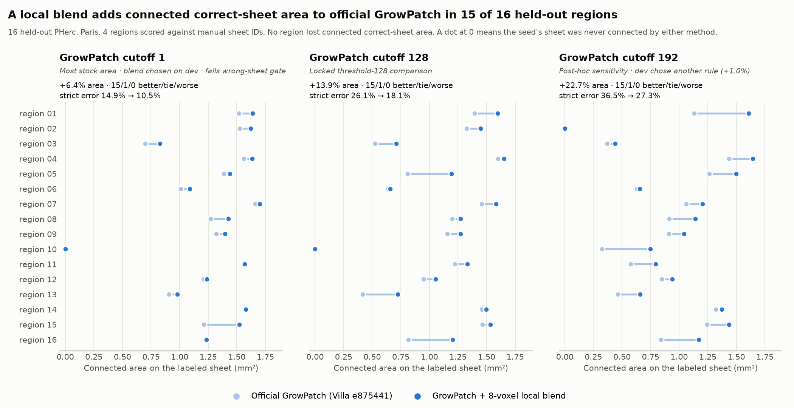
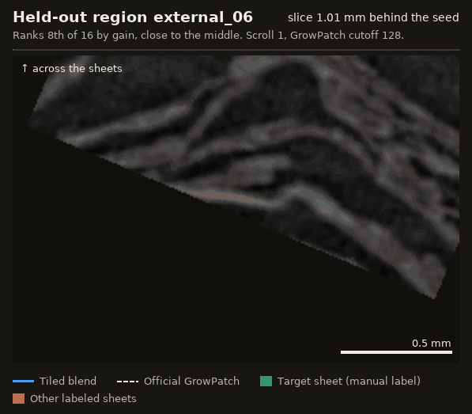
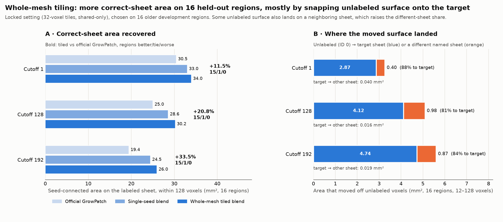
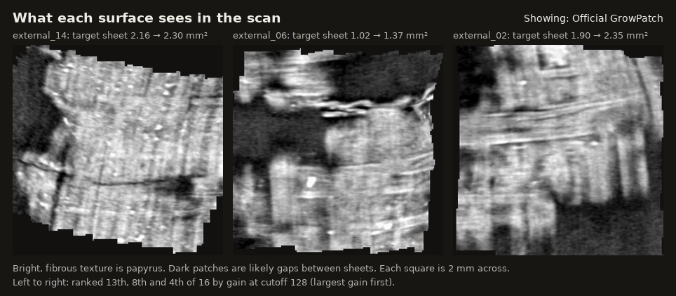
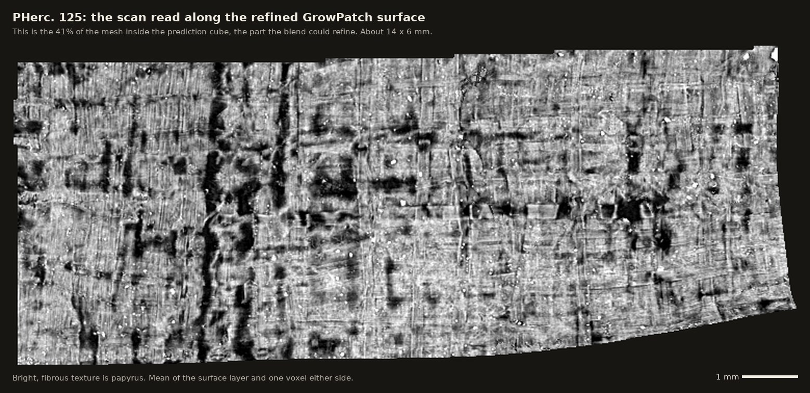
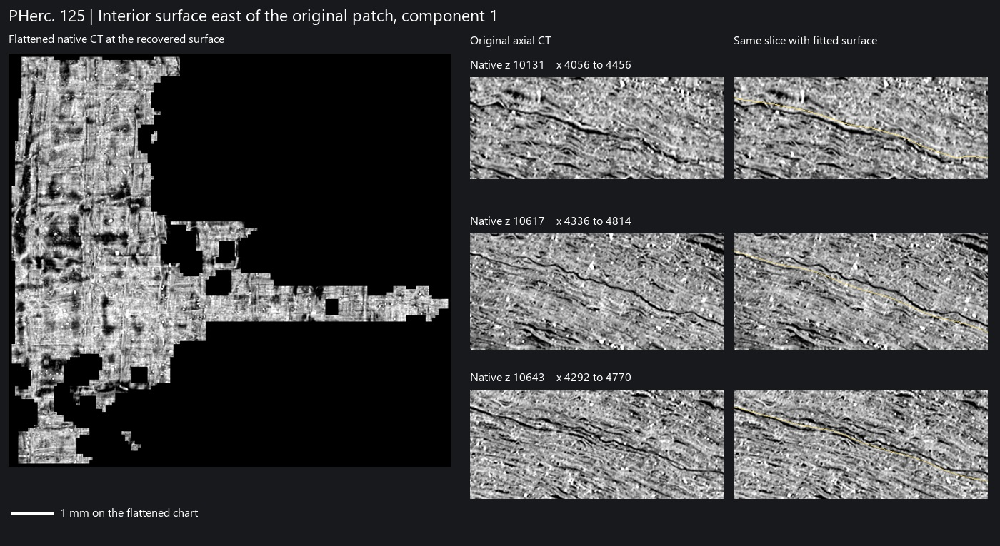

# Keeping GrowPatch on the right sheet

**A tool that tightens GrowPatch meshes onto the papyrus sheet they are following, tested against hand-labeled sheets. Plus 4.26 cm² of new surfaces on PHerc. 125 and PHerc. 268.**

*By Udeme Ekanem. Vesuvius Challenge Progress Prize submission, November 2026. Uses only public Vesuvius Challenge data. Everything runs on a CPU, except the optional ink-detection example, which needs a CUDA GPU.*

To read a rolled-up scroll, each papyrus sheet is traced as a surface, and the scan is read along that surface. GrowPatch, the tracer built into VC3D, does the tracing automatically, but it often drifts a few voxels off the sheet, so its surfaces still need fixing by hand. This project adds a refinement step that pulls a GrowPatch surface back onto the sheet it is following. It tests that step against sheets labeled by hand, and it lets anyone check the test region by region in an interactive explorer.

**How we got here.** Our first attempts were standalone tracers meant to replace GrowPatch. On held-out test regions they did not reliably beat GrowPatch (the first found 13% less of the right sheet; the second won only 7 of 16 regions), so we changed direction: keep GrowPatch, which already follows a sheet across long distances, and fix only its small, local drift. A rule that does this around a single seed point found more of the right sheet on held-out data, so we extended it to whole meshes by repeating it in tiles. We fixed its settings in advance and tested it once on hand-labeled regions. We then tried stricter versions to remove its wrong-sheet trade-off, report that they failed, and packaged the method for VC3D. Because a single percentage hides where the gain comes from and where it goes wrong, we also built a page where every test region can be inspected slice by slice.

## In short

- **What it does.** GrowPatch, the surface tracer in VC3D, often leaves a mesh a few voxels off the papyrus sheet, on voxels with no sheet label (probably the gap between sheets or a sheet's edge). Our tiled blend fixes that across a whole mesh. In tiles over the mesh it grows a second, independent trace of the same surface prediction. Wherever both see a single sheet within 8 voxels of each other, it moves the mesh halfway toward the trace. Everywhere else it leaves GrowPatch alone. A GrowPatch mesh in tifxyz, VC3D's surface format, goes in; a refined tifxyz mesh comes out.
- **Does it work?** We tested it on 16 small regions of Scroll 1 where the papyrus sheets were labeled by hand. We fixed its settings on 16 other regions first, then ran it once. Within about 1 mm (128 voxels) of each seed, it found **11.5%, 20.8% and 33.5% more of the right sheet** than official GrowPatch at GrowPatch's three cutoff settings (1, 128 and 192; the cutoff is how strong the surface prediction must be for GrowPatch to follow it). It did better in 15 regions, tied in 1, and was never worse. The part of the mesh that is not on the target sheet fell from 29.8% to 20.2% at cutoff 128.
- **On a real scroll.** It refines a full official GrowPatch mesh from PHerc. 125 in about two minutes with 20 worker processes; the 41% of that mesh inside its prediction cube is what gets refined. A rerun reproduces the output byte for byte, and the scan read along the refined surface shows papyrus fibers.
- **For VC3D.** The same code is packaged as a villa `segmentation/` tool, ready to propose to VC3D as a draft pull request ([vc3d-tool](vc3d-tool/README.md)).
- **New surfaces.** Ten tifxyz meshes cover 4.259 cm² in native scan coordinates: 3.502 cm² on PHerc. 125 and 0.757 cm² on PHerc. 268. 1.62 cm² of the PHerc. 125 area agrees within 6 voxels with a public community winding. Three southern pieces disagree with it and are marked unresolved. A published ink detector runs on the meshes; no letters are claimed.
- **Trade-off.** The blend also lands some surface on neighbouring sheets. Of the surface that lands on any labeled sheet, the part on a wrong sheet goes from 1.66% to 4.14% at cutoff 128, so it does not meet the strict no-increase check we set in advance. Almost nothing already on the right sheet is moved off it. At cutoffs 1 and 128, most of the extra is in one test region where GrowPatch never connects the target sheet to the seed. The blend tightens whatever sheet GrowPatch is following; it does not fix sheet switches. Seven stricter versions we tried did not remove the rise without losing most of the gain ([what we tried](evidence/safe/README.md)).



## Why this matters

The Vesuvius Challenge's 2026 list of open problems names holes, merges and sheet switches as the meshing errors to fix, and says GrowPatch output still needs a person to inspect and correct it. On hand-labeled papyrus, much of the right sheet that GrowPatch misses is not lost to another sheet at all. The mesh sits on voxels with no sheet label (unlabeled papyrus or the space between sheets), and moving it a few voxels often puts it back on the sheet. With the single-seed version of the rule at cutoff 128, within 96 voxels of the seed, 2.05 mm² of surface moved from unlabeled voxels onto the target sheet, while 0.04 mm² moved the other way and only 0.006 mm² moved from the target onto a different sheet. The rule never moves a point where the two traces disagree by more than 8 voxels, or where either sees more than one sheet.

## See it for yourself

**[Open the interactive explorer](https://vesuvius-surface-patches.github.io/)** and slide through all 16 test regions. For each one you can see the scan, the hand-drawn sheet labels, where official GrowPatch put the surface, and where the tiled blend moved it. You can also see exactly which parts the scorer counted. To run it on your own machine, run `python -m http.server -d docs` and open `http://localhost:8000`.



*A slice moving through test region external_06, which ranks 8th of 16 by gain, close to the middle. The dashed white line is official GrowPatch and the blue line is the tiled blend. Green outlines the target sheet in the hand labels, and orange outlines the other sheets. Where GrowPatch and the second trace both see one sheet within 8 voxels of each other, the blue line moves halfway toward that trace. The blend never sees the labels. Where the two traces are further apart, or either sees several sheets, it leaves GrowPatch alone. ([MP4 version](figures/explorer_section_sweep.mp4))*

## Quick start

Python 3.12, CPU only. Run from the repository root.

```sh
python -m pip install -r reconstruction/requirements.txt
```

**1 · Check the release (about a minute, offline).** This verifies 174 payload checksums and 191 benchmark checksums, and recomputes all ten mesh areas from the coordinates.

```sh
python reconstruction/review.py verify
```

**2 · Render CT along one mesh.** This downloads the needed chunks directly from the Vesuvius Challenge bucket. It writes a 17-layer native CT stack, a mask and a preview, and checks them against the archived hashes. Any of the ten IDs in [`reconstruction/geometry.csv`](reconstruction/geometry.csv) works.

```sh
python reconstruction/review.py render PHerc0125_west_2 --work ../render-work
```

**3 · Refine a whole real GrowPatch mesh on PHerc. 125.** The example uses an official GrowPatch run (Villa `e875441`, 160 generations) seeded inside PHerc. 125. The fetch step downloads the matching surface-m7 prediction cube and checks its hash. The tiled blend then refines the whole mesh using the locked settings ([`tiled_blend_lock.json`](growpatch-blend/scripts/tiled_blend_lock.json)). The x/y/z TIFFs should match [`whole-mesh-output`](examples/pherc125-blend-demo/whole-mesh-output) byte for byte.

```sh
python examples/pherc125-blend-demo/fetch_m7_cube.py --out ../blend-work/m7.npy
python growpatch-blend/scripts/growbench_tiled_blend.py examples/pherc125-blend-demo/stock-growpatch ../blend-work/m7.npy ../blend-work/whole --origin 3584 3008 10176 --stock-local
```

To use your own mesh, pass any GrowPatch `tifxyz` folder, a ZYX surface-prediction cube covering it, and the cube's global XYZ origin. Add `--stock-local` if the mesh coordinates are relative to the cube origin. The output folder holds an editable `tiled-blend.tifxyz` in global coordinates (VC3D-compatible, grid 4× denser than an 8-voxel GrowPatch grid), the per-vertex displacement and a report. Tiles with no surface ridge within 6 voxels of the mesh keep the GrowPatch position. The original single-seed tool, `growbench_refine_mesh.py`, is still included ([example](examples/pherc125-blend-demo/README.md)).

**4 · Reproduce the benchmark.** Each region fetches its public inputs from the organizer, so network access is needed even for one. See [`growpatch-blend/README.md`](growpatch-blend/README.md).

```sh
cd growpatch-blend
python scripts/growbench_labels_replay.py manual_external external_01 --manifests sources --output-root ../../fresh_inputs
python scripts/growbench_review.py . ../../case01-review --case external_01 --source-root ../../fresh_inputs
```

## Results on 16 held-out labeled regions

The regions are 96-voxel-radius discs in the 7.91 µm PHerc. Paris. 4 (Scroll 1) scan, each with Vesuvius Challenge manual volumetric instance labels. No region's source voxels were used in development. Some sheet IDs also appear as neighbors in earlier cubes. For each stock setting, the candidate rule was selected on separate development regions and locked before these 16 were scored. The 8-voxel blend was chosen at cutoffs 1 and 128. Both methods share the same upstream foreground and seed. Area counts only correct-sheet samples connected back to the seed, excluding a central collar both methods are given.

| GrowPatch cutoff | Connected correct area, stock → blend (mm²) | Change | Region-paired 95% interval (mm²) | Better / tie / worse (area) | Strict error* | Different named sheet, share of named hits |
|---|---:|---:|---:|---:|---:|---:|
| 1 (most stock area) | 19.64 → 20.89 | **+6.4%** | +0.74 to +1.93 | 15 / 1 / 0 | 14.9% → 10.5% | 2.93% → 2.96%‡ |
| 128 (locked threshold-128 comparison) | 16.43 → 18.73 | **+13.9%** | +1.45 to +3.26 | 15 / 1 / 0 | 26.1% → 18.1% | 1.31% → 1.24% |
| 192 (sensitivity only)† | 13.33 → 16.35 | +22.7% | +2.04 to +4.09 | 15 / 1 / 0 | 36.5% → 27.3% | 3.41% → 3.18% |

\*Strict error is the share of accepted area that is on a different named sheet, ambiguous, or unassigned. †At cutoff 192, development data selected a tapered seed offset instead. That rule gained only +1.0% (7 better, 2 tied, 7 worse), so the blend row here is a post-hoc sensitivity check. ‡This small rise fails the protocol's safety gate, which forbids any increase in the different-sheet share. Intervals are region-paired bootstrap intervals from the regional records. A separate resampling run gives +1.44 to +3.26 mm² at cutoff 128. Per-region values, development selections and every other candidate rule are in [`evidence/held-out-regions`](evidence/held-out-regions).

At cutoffs 1 and 128 the tie is region 10, where both methods land partly on a different named sheet and never connect the seed's sheet. At cutoff 192 it is region 2. "None lost area" refers to connected correct-sheet area. At cutoff 128, 4 of 16 regions had a slightly larger different-sheet fraction of accepted area. The [region maps](reconstruction/benchmark/external_blend_changes.png) show where target area was gained and where a different sheet was touched. A [second implementation of the scoring step](reconstruction/benchmark/external_resampling.md) reproduced every per-region total. It shares the projection lattice and samples the native sheet IDs independently. It also checks leave-one-region-out and spatially grouped resampling for the cutoff-128 comparison. Reloading all 16 cases from the public source matched all 80 expected input and reference array hashes ([receipt](reconstruction/benchmark/full_public_replay.json)).

**What did not work.** These results are part of the record. The first method, a standalone two-direction tracer, lost 13.2% connected area to GrowPatch on eight held-out vetted regions, and lost again on four reserved ones. A confidence-gated standalone graph cut placement errors sharply but won only 7 of 16 regions against cutoff-1 GrowPatch. These results are why the final method keeps GrowPatch and only refines it locally. Later, seven stricter versions of the tiled blend were pre-registered to remove its wrong-sheet rise. None passed the safety check on the development regions, so none was run on the test regions ([what we tried](evidence/safe/README.md)). All protocols, locks and losing comparisons are in [`growpatch-blend/protocols`](growpatch-blend/protocols) and [`growpatch-blend/measurements`](growpatch-blend/measurements).

## Whole-mesh tiling

The single-seed result only says the rule works near one trusted seed. To make it a tool for whole meshes, the same rule is tiled across a GrowPatch mesh:

- Tile seeds sit on a 32-voxel lattice laid over the mesh's own grid, independent of any evaluation seed.
- Each tile runs the unmodified graph solver and the unmodified 8-voxel half-way rule.
- Shifts are transferred to a 2-voxel resampling of the mesh and combined with weights that fall to zero at the 96-voxel tile edge.

Everything except two settings was fixed in a [pre-registered protocol](growpatch-blend/protocols/growpatch-tiled-blend-protocol.md). The two settings were lattice spacing (32 or 64 voxels) and whether tiles that kept stock count when combining. They were chosen on the 16 older development regions and written to a [lock file](growpatch-blend/scripts/tiled_blend_lock.json) before the held-out run. As a check on the transfer step, a single tile at the evaluation seed approximately reproduces the single-seed blend within 96 voxels: +6.3%, +13.8% and +19.9% against +6.4%, +13.9% and +22.7%.



| GrowPatch cutoff | Zone | Connected correct area, stock → tiled (mm²) | Change | 95% interval (mm²) | Better / tie / worse | Strict error | Different sheet, share of named hits |
|---|---|---:|---:|---:|---:|---:|---:|
| 1 | r ≤ 96 | 19.64 → 20.98 | +6.8% | +0.80 to +1.98 | 15 / 1 / 0 | 14.9% → 10.1% | 2.93% → 3.77% |
| 1 | r ≤ 128 | 30.48 → 33.98 | +11.5% | +2.20 to +5.07 | 15 / 1 / 0 | 17.9% → 11.3% | 2.94% → 3.73% |
| 128 | r ≤ 96 | 16.43 → 19.13 | +16.4% | +1.83 to +3.65 | 15 / 1 / 0 | 26.1% → 17.1% | 1.31% → 4.24% |
| 128 | r ≤ 128 | 25.02 → 30.22 | +20.8% | +3.58 to +6.95 | 15 / 1 / 0 | 29.8% → 20.2% | 1.66% → 4.14% |
| 192 | r ≤ 96 | 13.33 → 16.67 | +25.1% | +2.37 to +4.40 | 15 / 1 / 0 | 36.5% → 26.5% | 3.41% → 4.79% |
| 192 | r ≤ 128 | 19.44 → 25.96 | +33.5% | +4.53 to +8.64 | 15 / 1 / 0 | 41.4% → 30.3% | 5.22% → 6.91% |

These are the same 16 held-out regions as above. The inner 96-voxel disc was therefore scored once before. The 96–128-voxel ring was not, and it shows the largest gains: +20.1%, +28.7% and +52.1%. Compared with the single-seed blend, tiling adds +2.9%, +5.7% and +6.2% within 128 voxels (15/1/0 each). Most of that comes from the outer ring, where the single seed has little or no chart. Inside 96 voxels the difference is small: +0.4%, +2.2% and +2.0%, with 10–12 regions better and 3–5 worse.

**The safety gate fails.** In every cutoff and zone, the tiled blend raises the share of named hits on a different sheet. That fails the gate the single-seed protocol used, which allowed no increase. A pre-registered attempt to fix this with stricter rules failed at the development stage ([details](evidence/safe/README.md)).

**Where the extra different-sheet area comes from.** Rays were compared one by one between stock and tiled meshes, within 12–128 voxels of each seed ([transitions](evidence/tiled/transitions_manual_external.json)). Almost no correct surface leaves the target: 0.040, 0.016 and 0.019 mm² move from the target to another named sheet. The rise comes from GrowPatch surface that sat on unlabeled voxels and now lands on a sheet: 81–88% onto the target and the rest onto a neighboring named sheet. At cutoffs 1 and 128, most of the latter (97% and 90%) is in region 10, the region where the seed's sheet is never connected. So the tiled blend snaps GrowPatch onto the sheet it is already following. It is not a fix for sheet switches that GrowPatch already made.



*The scan's brightness read along each surface, seen from above, switching between official GrowPatch and the tiled blend once a second. Bright, fibrous texture is papyrus. Dark patches are likely gaps between sheets. From left to right, they rank 13th, 8th and 4th of 16 by gain at cutoff 128 (largest gain first), a spread from below-average to above-average gains rather than the best cases. The [explorer](https://vesuvius-surface-patches.github.io/) shows all 16.*

**Fresh cubes.** The pre-registered draw of unused labeled cubes, with no cube or target ID shared with earlier cohorts, found only 4 that qualified. That is short of the 8 required, so they are descriptive only. Official GrowPatch was run on them at all three cutoffs. Within 128 voxels the locked tiled blend gained +7.9%, +17.4% and +79.8% (6.03 → 6.51, 7.24 → 8.51 and 2.72 → 4.89 mm²). It was better in 11 of the 12 region-cutoff pairs and tied in the 12th ([results](evidence/tiled/fresh_manual_fresh.json)).

**On the real PHerc. 125 mesh.** Only 41% of the official 160-generation GrowPatch mesh lies inside the prediction cube it was grown on; GrowPatch extrapolated the rest. The tiled blend moved 208,215 of the 209,450 resampled vertices inside the cube (median move 0.13 voxels, 95th percentile 1.9 voxels). Outside the cube it moved only 18 vertices, all at the edge. A rerun from this repository, with Python 3.12 and 20 worker processes, reproduced the output byte for byte in about two minutes. A mesh lying fully inside its prediction cube would solve more tiles and take longer. There is no sheet-ID annotation on PHerc. 125, so this demonstrates scale and compatibility, not accuracy. [Displacement map](figures/pherc125_tiled_displacement.png) · [Run report](examples/pherc125-blend-demo/whole-mesh-output/report.json)



*The PHerc. 125 scan read along the refined part of the mesh, the 41% inside the prediction cube. It covers about 14 × 6 mm. Papyrus fibers running in both directions are visible across the surface. The original GrowPatch surface gives a very similar picture here, because most points moved less than a voxel (the raw scan values differ by 3.5 out of 255 on average). [`tools/pherc125_surface_render.py`](tools/pherc125_surface_render.py) makes this image by reading the scan straight from the public Vesuvius Challenge bucket.*

## The surfaces



Each mesh is a standard `tifxyz` folder (`x.tif`, `y.tif`, `z.tif` and `meta.json`) in global level-0 voxel coordinates of the official volume. It has an 8-voxel grid (`scale` 0.125), and invalid vertices are −1. It opens in VC3D and renders with `vc_render_tifxyz`. The PHerc. 125 meshes use volume `20250821151825` (9.362 µm). PHerc. 268 uses `20251110183117` (8.640 µm).

| Mesh | Area (cm²) | Within 6 vox of community winding (cm²) | Status |
|---|---:|---:|---|
| PHerc0125_y3310 | 1.219 | 0.748 | Mostly on community winding w070 (61% within 6 vox, median 3.9 vox) |
| PHerc0125_y3706 | 0.936 | 0.342 | Partly on w035 (37%, median 6.7 vox) |
| PHerc0268_y2991 | 0.757 | n/a | No community winding nearby. Cross-section and held-out contour checks only |
| PHerc0125_east | 0.339 | 0.213 | Mostly on w070 (63%). Official GrowPatch matched 98.1% within 3 vox in the scored crop |
| PHerc0125_north | 0.230 | 0.209 | On w070 (91%, median 2.3 vox) |
| PHerc0125_west | 0.026 | 0.022 | On w070 (83%) |
| PHerc0125_west_2 | 0.011 | 0.000 | Within 12 vox only. Weak |
| PHerc0125_south | 0.401 | 0.012 | **Unresolved.** Diverges from w070 below z ≈ 9,000 |
| PHerc0125_south_2 | 0.331 | 0.072 | **Unresolved.** Same divergence |
| PHerc0125_south_3 | 0.011 | 0.002 | **Unresolved** |

The community windings are from [pscamillo/vesuvius-eligible-meshes](https://github.com/pscamillo/vesuvius-eligible-meshes) (MIT): spiral-fit windings on a 20-voxel grid (grid scale 0.05), with only a subset of windings published. Its author reports that 12 of the 340 PHerc. 125 windings were inspected by eye. The windings are fitted by a different method but snapped onto the same organizer m7 prediction our traces use. Agreement is therefore corroboration, not independent ground truth. Where the two agree, each supports the other. At the south extensions they part by up to about four sheet spacings. Vertical CT sections through both ([x = 3036](figures/pherc125_south2_section_x3036.png), [x = 3476](figures/pherc125_south_section_x3476.png)) do not settle which trace stays on the original sheet, so the south meshes should not be used without review. Per-quad agreement masks and the script are in [`evidence/community-agreement`](evidence/community-agreement) and [`tools/community_agreement.py`](tools/community_agreement.py).

The extensions grew from the Y3310 patch in four directions, using several independently seeded routes on the organizer's surface-m7 prediction. Only regions where the routes agreed were kept. More cross-sections, coverage maps and the stricter organizer-curve masks (0.813 cm²) are in [`reconstruction/README.md`](reconstruction/README.md). More views: [Y3310 starting patch](figures/pherc125_y3310_ct_and_section.png) · [PHerc. 268 patch](figures/pherc268_y2991_ct_and_section.png) · [extension coverage](figures/pherc125_extensions_coverage.png).

## Ink detection on the new surfaces

The frozen four-scroll detector [`TequilaYuen/vesuvius-ink-9um-cross-scroll`](https://huggingface.co/TequilaYuen/vesuvius-ink-9um-cross-scroll) (seed 42, pinned revision) runs on the regenerated 17-layer CT without modification. It accepted 111 full 128 × 128 windows on four extensions, about 0.549 cm². A second run reproduced all 1,253,376 scores exactly. No readable letters appeared. This shows the meshes plug straight into an existing ink pipeline. [Commands and replay](reconstruction/README.md#run-a-published-ink-detector-on-regenerated-ct) · [East output](figures/pherc125_east_ink_reader.png)

## Limitations

- The labeled validation covers one scroll: PHerc. Paris. 4 at 7.91 µm, 16 held-out regions from one annotation campaign, scored within 128 voxels of each seed. The held-out regions were scored twice, once for the single-seed rule and once for tiling. Only 4 fresh cubes qualified for a further check on unseen data. Other scans and resolutions are untested.
- Most of the gain comes from moving surface off unlabeled (ID 0) voxels onto the target. It does not show fewer sheet switches. Tiling raises the share of named hits on a different sheet: for example 1.66% → 4.14% within 128 voxels at cutoff 128. That is 0.50 → 1.46 mm² of different-sheet area against +5.2 mm² of seed-connected correct-sheet area. Even the single-seed rule raised the share slightly at cutoff 1 (2.93% → 2.96%), failing its protocol's safety gate.
- Seven stricter versions failed to remove that rise on the development regions. At cutoffs 1 and 128, more than half of it comes from regions where GrowPatch never connects the target sheet to the seed, which the blend cannot detect from the mesh and the prediction alone.
- The VC3D tool's core matches the benchmark output exactly, but its `vc_reader` input/output wrapper has not been run yet, because vc_reader needs a native build.
- A tile abstains when the frozen solver finds no usable surface ridge: none within 6 voxels of the seed, an empty chart, or no connected ridges. That happened for 26% of held-out tiles. An abstaining tile contributes nothing, so where no neighbouring tile solves, GrowPatch is kept even if it is wrong.
- The PHerc. 125 and 268 meshes have no independent human sheet-ID annotation. The routes, the stock comparison and the community winding all depend on organizer surface predictions.
- No ink or text is claimed on any of the meshes.

## Repository layout

| Path | Contents |
|---|---|
| [`growpatch-blend/`](growpatch-blend) | Single-seed and whole-mesh (`growbench_tiled_blend.py`) blend code, graph tracer, frozen protocols and locks (including the failed stricter attempt), 16 labeled cases, all measurements, replay and evaluation scripts |
| [`vc3d-tool/`](vc3d-tool) | The blend packaged as a villa `segmentation/` tool for VC3D, with the patch for a draft pull request |
| [`examples/pherc125-blend-demo/`](examples/pherc125-blend-demo) | Official GrowPatch mesh on PHerc. 125, fetch script, expected single-seed and whole-mesh outputs |
| [`reconstruction/`](reconstruction) | The ten meshes, source manifests, CT render and rebuild code, ink-reader example. Checksummed (`SHA256SUMS`) |
| [`evidence/`](evidence) | Per-region held-out results for all three cutoffs, whole-mesh tiling results (development, held-out, fresh, ray transitions, lock), the failed stricter attempt (`evidence/safe/`), longer official GrowPatch run on the east extension, community-winding agreement masks |
| [`docs/`](docs) | The interactive explorer, published at https://vesuvius-surface-patches.github.io/, plus the images and traces it shows. `tools/explorer_meshes.py` and `tools/build_explorer.py` rebuild it from the project's data folder, and stop if the regenerated meshes or the counted areas differ from the held-out results file |
| [`figures/`](figures) · [`tools/`](tools) | Figures in this README and the scripts that make them |

## Credits and terms

The papyri are held by the Biblioteca Nazionale di Napoli (PHerc. 125, 268) and the Institut de France (PHerc. Paris. 4). The PHerc. 125 and 268 scans and surface-m7 predictions are from the Vesuvius Challenge open data. The 7.91 µm Scroll 1 scan is from EduceLab-Scrolls (Parsons et al., 2023). The volumetric instance labels are from the Vesuvius Challenge release. GrowPatch is from [ScrollPrize/villa](https://github.com/ScrollPrize/villa) at `e875441`. The community windings used for the cross-check are by GitHub user `pscamillo`. Derived meshes and imagery carry the source data terms. [Full attribution and data terms](reconstruction/source-credits.md)

Original code in this repository is released under the MIT License ([LICENSE](LICENSE)). Third-party code keeps its own license ([ink-reader architecture](reconstruction/ink-reader/reader_code/hybrid_reference/LICENSE)).
